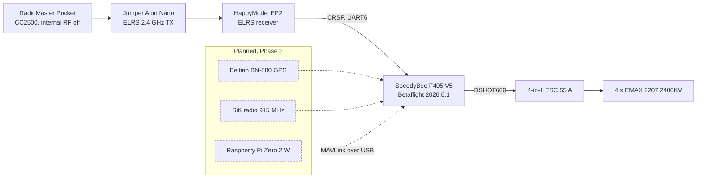

# Morpheus

A 5-inch FPV quadcopter I designed, built and configured myself, and the record of how I debugged it. It flies today under manual control. Autonomous flight is the next phase and is **not built yet**.

**Ernesto Guemez** · Monterrey, Mexico · October 2026

- Project page: https://ernestoguemez.github.io/morpheus-drone/
- Engineering report (PDF): [`docs/morpheus-report.pdf`](docs/morpheus-report.pdf)

## Status

| Phase | Scope | Status |
|---|---|---|
| 1 | Build: frame, motors, soldering, electronics, configuration | Done |
| 2 | Manual flight and tuning: drift, oscillation, PID, RPM filtering | In progress |
| 3 | Autonomy: ArduPilot, GPS, telemetry, Raspberry Pi, Python missions | Planned, not built |

What works today: the drone arms, hovers and is flown by hand. The failsafe cuts the motors about one second after the radio is switched off.

What does not exist yet: any autonomous behavior. There is no GPS, no companion computer and no mission code on the drone. See [`phase3-autonomy/`](phase3-autonomy/README.md) for the plan.

## Why this project

I want to study aerospace engineering, and I realized a drone is a complete aircraft system in miniature. I wanted to build one so I couldn't treat any of its systems like a black box. I had never touched a soldering iron before this, so I picked up the skills as the build demanded them. The dream is a drone that takes off, flies a GPS route, and lands on its own using Python on a Raspberry Pi. We're not there yet, though. This repository documents the steps toward it, including the failures.

## Architecture



Dashed boxes are planned and not installed.

## Hardware

| Part | Specification |
|---|---|
| Frame | Mark4 5 in carbon fiber, 5 mm arms, 16 x 16 mm motor mount |
| Motors | EMAX ECO II 2207 2400KV x 4 |
| Flight controller / ESC | SpeedyBee F405 V5 stack, 55 A 4-in-1 ESC |
| Receiver | HappyModel EP2, ELRS 2.4 GHz |
| Radio | RadioMaster Pocket (CC2500) with Jumper Aion ELRS Nano external module |
| Propellers | HQProp 5 x 4.3 x 3 V1S |
| Battery | GNB 4S 1300 mAh LiPo, 120C |
| Weight | About 650 g |

More detail, wiring notes and safety practices: [`hardware/`](hardware/README.md). Firmware settings: [`firmware/`](firmware/README.md).

## Engineering log

Five failures I diagnosed, each one needing a different kind of thinking:

1. **The wrong motors.** Sourcing diligence. The title is marketing, the variant is the contract.
2. **A radio that could not speak to the receiver.** Systems thinking. ELRS and CC2500 are different silicon.
3. **The drone that would not arm.** Methodical debugging. The radio's "armed" is the radio's opinion.
4. **Motors screaming, no lift.** Systematic elimination. All four propellers were upside down.
5. **A smoke stopper from a car bulb.** Safety and resourcefulness.

Full write-ups with symptom, diagnosis, root cause, fix and lesson: [`engineering-log.md`](engineering-log.md).

## Repository layout

```
docs/                  Project website (GitHub Pages) and the PDF report
  index.html           The site
  assets/photos/       Photos used by the site and the report
engineering-log.md     The five failures, plus smaller fixes
hardware/              Parts, wiring notes, safety practices
firmware/              Betaflight settings and configuration exports
phase3-autonomy/       Plan for autonomous flight (not built)
tools/                 Small helper scripts
```

## Photos

The site reads its photos from `docs/assets/photos/`. Use these names, in `.jpg`:

`frame`, `solder`, `stack`, `config`, `log1_motors`, `log2_menu`, `log2_module`, `log3_cli`, `log3_modes`, `log4_noLift`, `log5_bulb`

A missing file shows a labelled placeholder.

## AI disclosure

I designed, built, debugged, and flew Morpheus myself. I used AI tools while building this website. All engineering work, decisions, and experiences documented here are my own.
